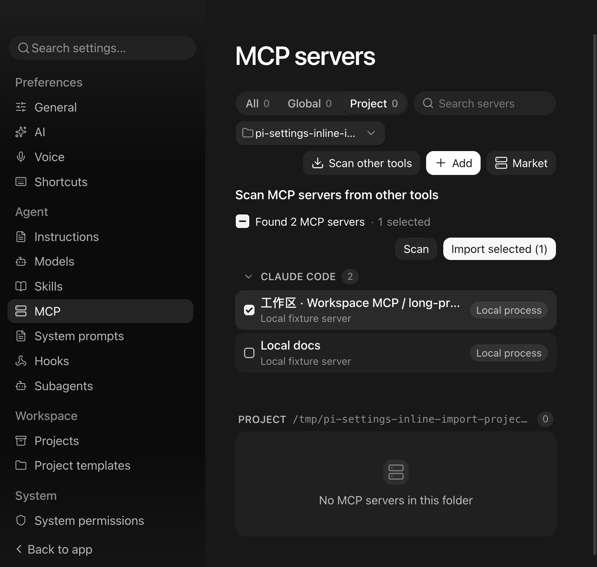
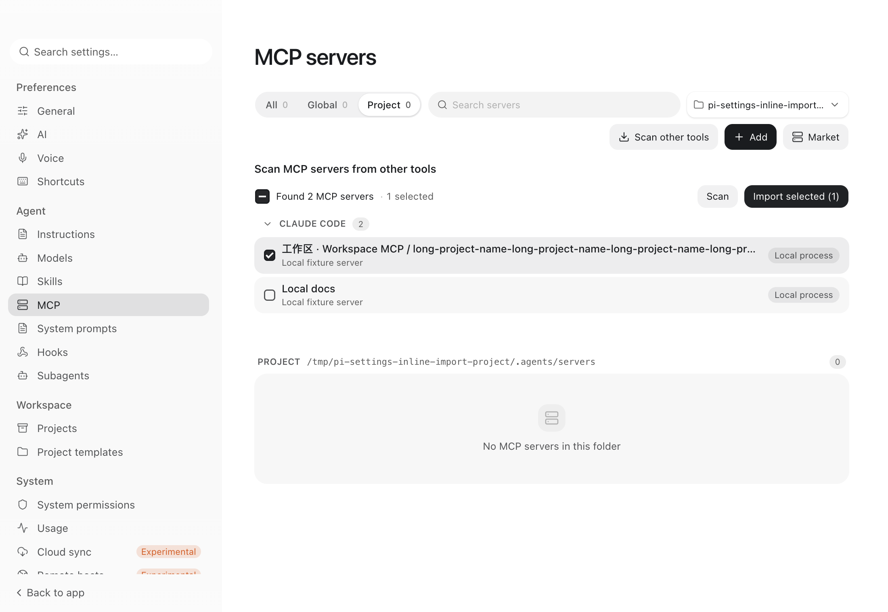

# mc-agent 桌面 UI 开发规范

改页面时，先明确用户在这里看什么、做什么，以及操作完成后怎样确认结果。聊天正文、代码、Diff 和工具输出占主区域。导航说明当前位置，工作面板承载当前任务的辅助信息。外壳的两列结构和状态色约定见 [MC-ADR-0029](adr/mc-0029-zen-shell-and-orca-loop.md)。

## 颜色、字号和间距

Renderer 的设计变量集中在 `apps/desktop/src/styles/tokens.css`。基础值放在 `:root`，浅色主题覆盖需要变化的值。组件按用途选变量，插件主题也能随之生效。

| 要画什么 | 选择 |
| --- | --- |
| 页面、内容分组、弹层 | 页面用 `--ds-bg-primary`，页内分组用 `--ds-tile`，悬浮菜单用 `--ds-bg-elevated-opaque`。先用留白和层次分组，避免卡片层层加框 |
| 正文、说明、元数据 | 正文用 `--ds-text-primary`，说明用 `--ds-text-secondary`，路径、计数等次要信息用 `--ds-text-muted`。错误原因和操作条件要能直接读到 |
| 当前选择、焦点、结果 | 选择实底用 `--ds-accent`，键盘焦点用 `--ds-focus`。成功、警告和失败分别用 `--ds-success`、`--ds-warning`、`--ds-error`，同时给出文字、图标或勾选标记 |
| 字号和圆角 | 正文从 `--text-base`（默认 14 px）、紧凑行标题从 `--text-md`（13 px）、辅助信息从 `--text-sm`（12 px）开始。字号随外观设置缩放。行高、字重和圆角分别取 `--leading-*`、`--font-weight-*`、`--radius-*` |
| 间距和控件尺寸 | 共用固定间距从 `--ds-space-2/4/6/8/12/16` 中取，数字是 CSS 像素。图标与文字常用 4 或 6，同行元素用 8，分组内边距用 12 或 16。独立区块可留 24，页面边缘可留 32。图标按钮、输入框高度优先沿用组件的 `--ds-control-size`、`--ds-field-height` |

主操作用实底，返回、取消和关闭保持中性。已选、悬停和键盘焦点要能区分。检查文字和实际背景叠加后的对比度，普通文字目标至少 4.5∶1，大字至少 3∶1。代码高亮、Diff 内容和图片预览保留各自的内容配色。完整刻度和例外见[基础设计系统](../zh-CN/spec/04-ux/07-ui-design-system.md)。

## 按交互选组件

| 用户要做的事 | 从哪里开始 |
| --- | --- |
| 执行动作、输入、勾选 | 用 `Button`、`Field`、`Input`、`Checkbox`。图标动作通过 `TooltipButton` 提供可访问名称。批量勾选同时表达全选、未选和部分选中 |
| 在设置中调整一项 | 用 `SettingsCard`、`SettingsRow`。开关用 `SettingsToggle`，互斥选项用 `SegmentedControl`，较长列表用 `SettingsMenuSelect`。一般说明放帮助入口，费用、授权和不可逆后果在操作前可见 |
| 切换视图、打开菜单或弹窗 | 控制实际内容面板的页签用 `tablist` 并关联面板。分段单选或页签组保留一个 Tab 停靠点，方向键移动选择。弹出选项要在视口内，Esc 关闭回到触发控件。模态窗口持有焦点，关闭后送回原操作位置 |
| 显示工作进度或失败 | 区分加载中、没有数据、执行失败和完成。写入期间标记忙碌并阻止重复提交。失败时保留可以修改的输入，写明原因和可执行的下一步。成功后让用户在原处看到结果 |

控件目录见 [Renderer 约定](../../apps/desktop/src/AGENTS.md)。新文案进 `packages/i18n`，至少补齐英文和简体中文。路径、命令和用户生成内容应可读取或复制。省略长名称时保留可访问的全名，操作按钮保持可达。

## 开发与验收

| 改动 | 怎么验证 |
| --- | --- |
| 改 Renderer CSS、主题或控件 | `pnpm check:ui` 与 CI 的 `pnpm lint` 共用检查。它查未定义的 `--ds-*`（含有回退值的引用）、裸字号与圆角，以及设置页里手写的原生下拉框和开关按钮。表面颜色检查覆盖设置、编辑框和菜单等指定区域 |
| 改颜色或主题切换 | 构建桌面包，跑 `pnpm test:e2e:theme-surfaces`。Chromium 会测量两套内置主题里主按钮和设置搜索文字的实际对比度，并验证自定义主题覆盖。其余文字、遮挡、焦点环和阅读顺序在受影响的窗口检查 |
| 改布局或共用交互 | 用隔离开发实例走一遍受影响的操作。在常用宽度和窄窗口放入真实长度的数据，试大字号、中英文标签和键盘。内容列先收缩，工具栏可以换行。可滚动面板应能访问最后一项。涉及动效时检查系统的减少动态效果设置 |
| 提交 PR | 在「验证」写明操作、平台、窗口尺寸及未覆盖状态。涉及布局或可见差异时，附能说明问题的截图或录屏。采集测试数据，保留关键控件和状态 |

设置导入提供了一个可复用的验收例子。先运行 `pnpm --filter @pi-desktop/desktop build`，再运行 `pnpm test:e2e:settings-inline-import`。测试在隔离 Electron 窗口切换项目筛选、只勾选两个 MCP 候选中的一个并执行导入。它检查键盘焦点、全选框的半选标记、长名称和操作按钮的边界，以及最终的导入结果。设置环境变量 `PI_E2E_ARTIFACT_DIR` 可以保存勾选时的四张截图。

| 深色 · 800 px · 125% 字号 | 浅色 · 1100 px · 默认字号 |
| --- | --- |
|  |  |
